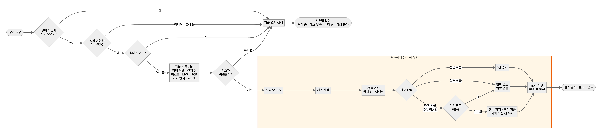
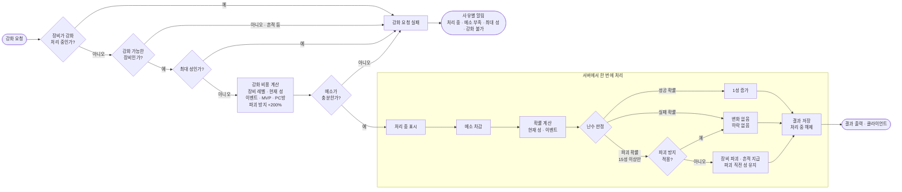

# 메이플스토리 스타포스 강화 시스템 역기획서

## 0. 요약

| 항목 | 내용 |
|---|---|
| 대상 | 메이플스토리 스타포스 강화 (KMS, 2026.03 개편 기준) |
| 핵심 구조 | 메소를 내고 성공 · 실패 · 파괴 판정. 실패해도 하락하지 않고, 파괴돼도 흔적이 파괴 직전 성을 유지 (22성 상한) |
| 데이터 설계 | 확률(현재 성) · 레벨 구간 · 비용 공식 계수 · 고정 값 · 할인 · 이벤트 · 유저 · 장비 10개 테이블. 3장 규칙 18개를 전부 대조 (5장) |
| 수치 분석 | 250제 0 → 22성 평균 194억 · 파괴 2.65회. 상위 1% 불운은 463억 (평균의 2.4배). 비용의 3분의 2가 17 → 20성에 몰림 (6장) |
| 비교 | 로스트아크는 불운에 끝(장인의 기운)이 있고, 스타포스는 끝 없이 파괴를 흔적으로 완화 (7장) |
| 개선안 | 확률 슬라이더: 당긴 만큼 확률과 1회 비용을 함께 올려 기대 비용 유지. 80%에서 불운 격차 절반, 25%에서 파괴 1회 아래, 평균 소각은 그대로 (8장) |

## 1. 개요

### 1.1 시스템 정의

스타포스는 메이플스토리의 장비 강화 시스템 중 하나다.

- 장비마다 오를 수 있는 최대 성이 정해져 있고, 처음 얻었을 때는 0성에서 시작한다
- 메소를 내고 한 번에 1성씩 올린다. 최대 성에 도달하면 더 이상 강화할 수 없다
- 결과는 성공 · 실패 · 파괴 세 가지다. 성공하면 1성 오르고, 실패하면 그대로이며, 파괴되면 장비가 사라지고 「장비의 흔적」(잠재능력 · 추가옵션 유지)이 인벤토리로 들어온다
- 확률은 현재 성에 따라(슈페리얼 장비는 따로), 비용은 장비 레벨과 현재 성에 따라 달라진다. 성이 높을수록 성공 확률은 낮고 파괴 확률과 비용은 높다

### 1.2 기획 의도 (추정)

| 의도 | 내용 |
|---|---|
| 성장 수단 | 캐릭터를 강하게 만들어 더 높은 콘텐츠를 플레이할 수 있게 한다 |
| 메소 소비처 | 유저가 쌓아 둔 메소를 소비시켜 줄이고, 메소를 모으기 위해 보스 · 사냥을 할 동기를 준다 |
| 쾌감 | 성공 · 실패 · 파괴의 긴장감으로 성공했을 때 쾌감을 키운다. 콘텐츠 참여와 과금으로 이어진다 |

### 1.3 메이플 장비 성장 구조 안에서의 위치

장비 성장 수단은 크게 4가지(스타포스, 잠재능력, 추가옵션, 주문서 작)이고, 그중 스타포스는 장비의 **체급**을 담당한다. 유저 사이에 "별이 깡패"라는 말이 있을 정도로, 스펙이 낮을수록 스타포스가 차지하는 비중이 크다.

| 성장 수단 | 특징 |
|---|---|
| 주문서 작 · 추가옵션 | 상대적으로 가성비 있게 맞추기 쉽다 |
| 잠재능력 | 많은 옵션 중 원하는 옵션이 떠야 해서 기대 비용이 낮지 않다. 다른 유저가 돌리다 나온 장비가 경매장에 올라오기 때문에, 직접 돌리기보다 사는 게 싼 편이다 |
| 스타포스 | 18성 정도까지는 직접 하는 것과 사는 것의 차이가 크지 않아 직접 시도하는 경우가 많다 |

잠재능력은 지금 옵션보다 좋은 게 뜰 때까지 계속 돌려야 하는 막연함이 있다. 스타포스는 성공 · 실패 · 파괴로 결과가 단순명료해서 상대적으로 선호된다.

### 1.4 실패 · 파괴가 없었다면

- **유저**: 피곤함 없이 강화할 수 있다
- **메소**: 파괴가 없으면 장비를 다시 올릴 일이 없어 메소 소비가 크게 줄고, 인플레이션이 빨라진다
- **고성 장비**: 지금은 30성 풀강이 아직 나오지 않았지만, 파괴가 없으면 고성 장비 공급이 크게 늘어 희소성과 가격이 크게 떨어진다
- **성장 속도**: 강해진 유저가 더 높은 보스를 잡으면서 메소 · 드랍템 획득이 늘어난다. 대략 지금의 두 배 이상 빠르게 성장 인플레이션이 일어날 것이다

2025.03 개편에서 하락을 없앤 것도 같은 맥락으로 보인다. 유저의 피곤함은 줄이되 확률 · 비용을 조정해 강화 기대 비용은 유지했다. 메소 소비는 지키면서 유저가 편하게 누를 수 있게 만든, 회사 입장에서도 좋은 변화다.

## 2. 구조

### 2.1 입력 / 처리 / 출력

| 단계 | 내용 |
|---|---|
| 입력 | 장비 정보(레벨, 부위, 현재 성), 보유 메소, 인벤토리 정보, 파괴 방지 설정 |
| 처리 | 서버가 현재 성의 확률 · 비용과 설정을 확인하고 성공 · 실패 · 파괴를 판정 |
| 출력 | 현재 성, 파괴 여부(파괴 시 인벤토리에 흔적), 장비 스탯, 보유 메소 |

### 2.2 연결된 시스템

| 방향 | 시스템 (주고받는 것) |
|---|---|
| 스타포스로 들어옴 | 보스 (장비 · 메소), 사냥 (메소), 경매장 (장비 · 메소), 메이플 포인트 (메소), 에픽던전 주화 (메소) |
| 스타포스에서 나감 | 강해진 캐릭터 → 보스 · 사냥 · 에픽던전, 강화된 장비 → 경매장 |

### 2.3 경제 흐름에서의 위치

스타포스는 메소 · 장비(자원)를 소비해 캐릭터를 강화하는 **소비처(I/O 중 Out)**다.

다만 메이플은 경매장이 있는 I/O(B) 구조라서, 스타포스의 결과물(강화된 장비)이 저장 단계에 남아 다른 유저에게 넘어갈 수 있다. 그래서 스타포스 소비는 내 캐릭터에서 끝나지 않고, 경매장의 고성 장비 공급량에도 영향을 준다.

## 3. 규칙

> 처음 가설: 강화를 누르면 메소를 소모하고 성공 · 실패 · 파괴 확률에 따라 결과가 나온다. 자료로 확인하면서 아래처럼 정리했다.

### 3.1 강화 결과

| 결과 | 처리 |
|---|---|
| 공통 | 강화 비용(메소)을 차감한다. 차감 · 판정 · 결과 저장은 서버에서 한 번에 처리한다 (중간에 끊겨도 메소만 빠지는 일이 없게) |
| 성공 | 별이 1성 오른다 |
| 실패 | 아무 일도 일어나지 않는다. 별은 하락하지 않는다 (예전에는 하락이 있었음) |
| 파괴 | 장비가 파괴되고 「장비의 흔적」을 지급한다. 흔적은 추가옵션 · 잠재능력과 **파괴 직전 스타포스 수치**를 가진다 (23성 이상에서 파괴되면 22성, 슈페리얼 장비는 0성). 흔적으로 장비를 복구할 수 있다 ⚠️ 복구 절차 · 비용 확인 필요 |

> 출처: 2026.03.19 점검 스타포스 개편 공지 (흔적의 스타포스 수치 변경). 이전에는 흔적으로 복구하면 12 / 15성으로 돌아갔다.

### 3.2 결과를 바꾸는 요소

| 요소 | 조건 | 결과 |
|---|---|---|
| 현재 성 | 현재 n성 | 성공 · 실패 · 파괴 확률 = 확률표[n]. 15성 미만은 파괴 확률 0 |
| 장비 레벨 | 장비 레벨 L | 강화 비용 = 비용 공식(L, n), 최대 성 · 스탯 증가 계수 = 레벨 구간표[L] (5.2) |
| 스타캐치 (삭제) | 2026.03 개편으로 미니게임 삭제 | 예전 스타캐치 성공 시 오르던 성공 확률이 **항상** 적용된다 |
| 파괴 방지 | 적용 가능한 구간에서 파괴 방지를 켬 | 파괴 확률이 실패로 바뀐다 (파괴 0). 비용이 기본 비용의 200% 더 든다. 15 ~ 17성 (2025.03 개편: 17성까지 확대, 비용 100% → 200%) ⚠️ 시작 성 확인 필요 |
| 이벤트 | 강화 비용 할인 | 비용 × (1 − 할인율). 예: 30% 할인 (파괴 방지 추가 비용에는 적용 안 됨) |
| 이벤트 | 특정 성 100% 성공 | 5 · 10 · 15성에서 성공 확률 100% (샤이닝 스타포스) |
| 이벤트 | 파괴 확률 감소 | 파괴 확률 × (1 − 감소율). 예: 21성 이하 30% 감소 (썬데이 메이플, 2025.03 공지) |
| 할인 | MVP 등급 · PC방 | 비용 할인 ⚠️ 등급별 할인율 · 적용 구간 확인 필요 |
| 슈페리얼 장비 | 슈페리얼 장비 | 확률 · 비용표가 따로 있고, 이벤트 할인과 흔적 규칙에서 빠진다 |

### 3.3 예외 상황

| 상황 | 처리 |
|---|---|
| 메소가 모자랄 때 | 강화 버튼이 눌리지 않는다. 「메소가 부족합니다」 알림. 메소는 빠지지 않는다 |
| 이미 최대 성일 때 | 강화 버튼이 눌리지 않는다. 「더 이상 강화할 수 없습니다」 알림 |
| 파괴된 장비(흔적)를 강화하려 할 때 | 강화 대상으로 올릴 수 없다. 흔적은 복구에만 쓴다 |
| 강화 버튼을 누르고 결과 확인 전에 게임이 종료될 경우 | 서버가 요청을 받았으면 차감 · 판정 · 저장까지 끝낸다. 다시 접속하면 장비에 결과가 반영돼 있다 (연출은 다시 보여 주지 않음). 서버가 요청을 못 받았으면 아무것도 바뀌지 않는다 |
| 버튼 연타 · 요청 중복 | 장비에 "강화 처리 중" 표시를 걸고, 처리 중인 장비에 들어온 요청은 거절한다. 처리가 끝나면 표시를 푼다 |
| 이벤트가 끝나는 순간에 누른 강화 | **서버가 요청을 받은 시각** 기준으로 이벤트 적용 여부를 정한다 (클라이언트 시각은 믿지 않는다) |

## 4. 플로우 차트
### 4.1 강화 1회 플로우



- 판정 전에 거르는 것 (마름모 4개): 처리 중 → 장비 상태 → 최대 성 → 메소
- 주황 상자 안 (처리 중 표시 ~ 결과 저장 · 표시 해제)은 서버에서 한 번에 처리한다. 중간에 접속이 끊겨도 메소만 빠지는 일이 없다
- 파괴 방지는 비용 계산 (+200%)과 판정 뒤 분기 두 곳에 들어간다

<details><summary>Mermaid 원본 (고칠 때)</summary>



</details>

### 4.2 분기별 규칙 대응

| 분기 / 단계 | 대응하는 규칙 |
|---|---|
| 장비가 강화 처리 중인가? | 3.3 버튼 연타 · 요청 중복 (처리 중인 장비 → 거절) |
| 강화 가능한 장비인가? | 3.3 파괴된 장비(흔적)를 강화하려 할 때 |
| 최대 성인가? | 3.2 장비 레벨 (레벨 구간표) · 3.3 이미 최대 성일 때 |
| 강화 비용 계산 | 3.2 장비 레벨 (비용 공식) · 이벤트 (비용 할인) · 할인 (MVP · PC방) · 파괴 방지 (+200%) |
| 메소가 충분한가? | 3.3 메소가 모자랄 때 |
| 처리 중 표시 ~ 결과 저장 | 3.1 공통 (한 번에 처리) · 3.3 결과 확인 전 게임 종료 |
| 확률 계산 | 3.2 현재 성 (확률표) · 스타캐치 보너스 항상 적용 · 이벤트 (100% 성공, 파괴 감소) |
| 난수 판정 → 성공 / 실패 | 3.1 성공 (1성 증가) · 실패 (하락 없음) |
| 파괴 방지 적용? | 3.2 파괴 방지 (파괴 → 실패) |
| 장비 파괴 · 흔적 지급 | 3.1 파괴 (파괴 직전 성 유지, 23성 이상 → 22성) |
| 이벤트 적용 여부 (비용 · 확률 계산 안) | 3.3 이벤트가 끝나는 순간 (서버가 요청을 받은 시각 기준) |


## 5. 데이터 테이블 설계

### 5.1 테이블 구성

| # | 테이블 | 키 | 종류 | 나눈 이유 |
|---|---|---|---|---|
| 1 | 강화 확률 (일반) | 현재 성 | 기획 데이터 | 확률은 장비 레벨과 상관없이 현재 성으로만 정해진다 |
| 2 | 강화 확률 (슈페리얼) | 현재 성 | 기획 데이터 | 슈페리얼은 확률표가 따로 있다. 종류 컬럼을 키에 넣는 대신 표를 나눠, 일반 장비 표를 고칠 때 슈페리얼을 건드리지 않게 했다 |
| 3 | 장비 레벨 구간 (일반) | 최소 레벨 | 기획 데이터 | 최대 성과 스탯 증가 계수는 장비 레벨 구간으로 정해진다 |
| 4 | 장비 레벨 구간 (슈페리얼) | 최소 레벨 | 기획 데이터 | 3과 같은 구조, 값만 다르다 |
| 5 | 강화 비용 계수 | 장비 종류 + 시작 성 | 기획 데이터 | 비용은 장비 레벨 × 현재 성으로 바뀌어 표로 두면 칸이 수천 개다. 공식 하나와 성 구간별 계수 몇 줄로 둔다 |
| 6 | 고정 값 | 항목 | 기획 데이터 | 모든 장비 · 모든 성에서 같은 값. 한 곳에만 두어 고칠 때 빠뜨리지 않게 한다 |
| 7 | MVP 등급 할인 | MVP 등급 | 기획 데이터 | 상시 혜택이고 등급마다 값이 다르다 (이벤트와 분리) |
| 8 | 이벤트 | 이벤트 ID | 운영 데이터 | 기간이 있고 회차마다 값이 바뀐다. 기본 확률 · 비용 표를 고치지 않고 켜고 끌 수 있게 분리 |
| 9 | 유저 | 유저 ID | 저장 데이터 | 스타포스가 읽고 쓰는 유저 값 (메소, MVP 등급) |
| 10 | 장비 | 장비 ID | 저장 데이터 | 장비 하나하나의 상태 (현재 성, 흔적 여부, 처리 중 여부). 레벨 · 부위 · 슈페리얼 여부는 장비 마스터에서 가져온다 |

계산 순서: 장비(10) → 레벨 구간(3/4)에서 최대 성 확인 → 비용 계수(5) · 고정 값(6) · MVP(7) · 이벤트(8)로 비용 계산 → 유저(9) 메소 확인 → 확률(1/2) · 이벤트(8)로 판정 → 장비(10) · 유저(9) 저장

### 5.2 테이블 상세 (컬럼, 키, 실제 값)

> 출처: [2025.03.20 업데이트 공지 (스타포스 개편)](https://maplestory.nexon.com/news/update/767). ⚠️ 표시는 공식 자료로 아직 확인하지 못한 값 (게임 내 확률 정보에서 확인 필요). 2026.03 개편 반영 여부도 확인 필요.

**1. 강화 확률 (일반)** · 키: 현재 성

| 현재 성 | 성공% | 실패(유지)% | 파괴% | 파괴 방지 가능 |
|---|---|---|---|---|
| 0 ~ 14 | ⚠️ | ⚠️ | 0 | X |
| 15 | 30.00 | 67.90 | 2.10 | O |
| 16 | 30.00 | 67.90 | 2.10 | O |
| 17 | 15.00 | 78.20 | 6.80 | O |
| 18 | 15.00 | 78.20 | 6.80 | X |
| 19 | 15.00 | 76.50 | 8.50 | X |
| 20 | 30.00 | 59.50 | 10.50 | X |
| 21 | 15.00 | 72.25 | 12.75 | X |
| 22 | 15.00 | 68.00 | 17.00 | X |
| 23 ~ 25 | 10.00 | 72.00 | 18.00 | X |
| 26 | 7.00 | 74.40 | 18.60 | X |
| 27 | 5.00 | 76.00 | 19.00 | X |
| 28 | 3.00 | 77.60 | 19.40 | X |
| 29 | 1.00 | 79.20 | 19.80 | X |

- 성공 + 실패 + 파괴 = 100 이어야 한다 (데이터 검사 규칙)
- 파괴가 시작되는 성은 따로 두지 않는다. 파괴% > 0 인 첫 행으로 알 수 있고, 두 곳에 두면 서로 어긋날 수 있다
- 파괴 방지 가능 구간: 공지 기준 17성까지 확대. 시작 성은 파괴가 생기는 15성으로 둠 ⚠️

**2. 강화 확률 (슈페리얼)** · 키: 현재 성 · 컬럼은 1과 같음 · 값 ⚠️

**3. 장비 레벨 구간 (일반)** · 키: 최소 레벨

| 최소 레벨 | 최대 레벨 | 최대 성 | 주스탯 계수 | 공격력 계수 |
|---|---|---|---|---|
| 0 | 94 | ⚠️ | ⚠️ | ⚠️ |
| 95 | 107 | ⚠️ | ⚠️ | ⚠️ |
| 108 | 117 | ⚠️ | ⚠️ | ⚠️ |
| 118 | 127 | ⚠️ | ⚠️ | ⚠️ |
| 128 | 137 | ⚠️ | ⚠️ | ⚠️ |
| 138 | — | 30 | ⚠️ | ⚠️ |

- 성별 스탯 증가량 = 공식(현재 성, 계수, 장비 부위). 무기 / 방어구 구분은 장비(10)의 부위로 한다 ⚠️ 공식 형태 확인 필요

**4. 장비 레벨 구간 (슈페리얼)** · 컬럼은 3과 같음 · 값 ⚠️

**5. 강화 비용 계수** · 키: 장비 종류 + 시작 성

```
비용 = 기본 상수 + L³ × (현재 성 + 1)^지수 ÷ 나누는 값   (100 단위 반올림)
L = 장비 레벨
```

| 장비 종류 | 시작 성 | 끝 성 | 지수 | 나누는 값 |
|---|---|---|---|---|
| 일반 | 0 | ⚠️ | ⚠️ | ⚠️ |
| 일반 | ⋯ | ⋯ | ⋯ | ⋯ |
| 슈페리얼 | 0 | ⚠️ | ⚠️ | ⚠️ |

- 공지에 따르면 17 · 18 · 19 · 21성의 비용이 개편 때 올랐다. 이 성들은 따로 한 줄씩 둬야 할 수 있다 ⚠️
- 공식을 쓰면 기획자가 값을 한눈에 보기 어려우므로, 시트에서 레벨 × 성 미리보기 표를 만들어 검산한다

**6. 고정 값** · 키: 항목

| 항목 | 값 | 비고 |
|---|---|---|
| 성공 시 성 변화 | +1 | |
| 실패 시 성 변화 | 0 | 15성 이상 하락 없음 (2025.03 개편) |
| 흔적에 남는 성 상한 | 22 | 23성 이상에서 파괴되면 22성 |
| 슈페리얼 흔적에 남는 성 | 0 | |
| 파괴 방지 추가 비용 | 기본 비용의 200% | 2025.03 개편 (100% → 200%) |
| PC방 강화 할인율 | ⚠️ | |
| 비용 기본 상수 | ⚠️ | 5의 공식에 쓰임 |

**7. MVP 등급 할인** · 키: MVP 등급

| MVP 등급 | 할인율 | 적용 최대 성 |
|---|---|---|
| 브론즈 ~ 레드 | ⚠️ | ⚠️ |

**8. 이벤트** · 키: 이벤트 ID

| 컬럼 | 예시 값 |
|---|---|
| 이벤트 ID | 1 |
| 시작 시각 · 종료 시각 | 이벤트 기간 (서버가 요청을 받은 시각으로 비교) |
| 비용 할인율 | 30% ⚠️ |
| 100% 성공 성 목록 | 5, 10, 15 (샤이닝 스타포스) |
| 파괴 확률 감소율 | 30% (2025.03 공지, 썬데이 메이플) |
| 파괴 감소 적용 최대 성 | 21 (공지: "21성 이하에서") |
| 슈페리얼 적용 여부 | X |

**9. 유저** · 키: 유저 ID — 유저 ID, 보유 메소, MVP 등급 (→ 7), PC방 접속 여부 (접속 상태, 저장하지 않음)

**10. 장비** · 키: 장비 ID — 장비 ID, 유저 ID, 장비 레벨, 장비 부위, 슈페리얼 여부, 현재 성, 장비 상태 (정상 / 흔적), 강화 처리 중 여부

- 흔적은 같은 행의 장비 상태만 흔적으로 바꾼다. 추가옵션 · 잠재능력은 그대로 남고, 현재 성은 고정 값(6)의 상한으로 깎는다

### 5.3 규칙 표현 검증

| 규칙 (3장) | 표현되는 곳 |
|---|---|
| 3.1 공통: 비용 차감 · 판정 · 저장을 한 번에 | 처리 방식 (서버 트랜잭션). 데이터로는 장비(10) 강화 처리 중 여부 |
| 3.1 성공: 1성 증가 | 고정 값(6) 성공 시 성 변화 |
| 3.1 실패: 변화 없음 | 고정 값(6) 실패 시 성 변화 |
| 3.1 파괴: 흔적 지급, 파괴 직전 성 유지, 23성 이상은 22성, 슈페리얼 0성 | 장비(10) 장비 상태 · 현재 성, 고정 값(6) 상한 · 슈페리얼 흔적 성 |
| 3.2 현재 성 → 확률, 15성 미만 파괴 0 | 확률(1/2) |
| 3.2 장비 레벨 → 비용 · 최대 성 | 비용 계수(5) · 레벨 구간(3/4) |
| 3.2 파괴 방지: 파괴 → 실패, +200% | 확률(1) 파괴 방지 가능, 고정 값(6) 추가 비용. "파괴 → 실패"는 처리 규칙 |
| 3.2 이벤트 비용 할인 (파괴 방지 비용 제외) | 이벤트(8) 비용 할인율. 파괴 방지 제외는 처리 규칙 |
| 3.2 이벤트 100% 성공 | 이벤트(8) 100% 성공 성 목록 |
| 3.2 이벤트 파괴 확률 감소 | 이벤트(8) 파괴 확률 감소율 · 적용 최대 성 |
| 3.2 MVP · PC방 할인 | MVP 등급 할인(7), 고정 값(6) PC방 할인율, 유저(9) |
| 3.2 슈페리얼: 별도 확률 · 비용, 이벤트 제외 | 확률(2), 레벨 구간(4), 비용 계수(5) 장비 종류, 이벤트(8) 슈페리얼 적용 여부 |
| 3.3 메소 부족 | 유저(9) 보유 메소 |
| 3.3 최대 성 | 레벨 구간(3/4) 최대 성 |
| 3.3 흔적은 강화 불가 | 장비(10) 장비 상태 |
| 3.3 결과 확인 전 게임 종료 | 처리 방식 (서버 트랜잭션) |
| 3.3 버튼 연타 · 요청 중복 | 장비(10) 강화 처리 중 여부 |
| 3.3 이벤트가 끝나는 순간 | 이벤트(8) 시작 · 종료 시각 |

- 모든 규칙이 표의 컬럼이나 서버 처리 방식 중 하나로 표현된다
- 데이터가 아니라 처리 규칙으로 남은 것: 파괴 방지 시 파괴 → 실패, 할인이 파괴 방지 비용에 적용되지 않음, 한 번에 처리 (트랜잭션)


## 6. 수치 분석
### 6.1 목표 성까지 기대 비용 (평균 시도 횟수, 메소, 파괴 횟수)
**가설 (계산 전에 감으로)**: 250제 장비를 22성까지 올리면 80억, 파괴 1회

**계산 조건**
- 250제 방어구, 0성 → 22성. 파괴 방지 · 이벤트 · MVP 할인 없음
- 확률: 15 ~ 29성은 2025.03.20 공지 값. 0 ~ 14성 ⚠️ 커뮤니티 정리 값. 3.2의 상시 보너스(성공 × 1.05) 적용 ⚠️
- 비용: 5.2의 공식 (`1000 + L³ × (n+1)^지수 ÷ 나누는 값`, 100 단위 반올림). 계수 ⚠️ 커뮤니티 정리 값
- 파괴돼도 흔적이 파괴 직전 성을 유지하므로(22성 이하) 성은 떨어지지 않는다. **흔적 복구 비용은 빼고** 파괴 횟수로만 센다
- 방법: 하락이 없어서 n → n+1 은 성공 확률 p 인 기하분포다. 평균 시도 = 1/p, 평균 메소 = 1회 비용 ÷ p, 평균 파괴 = 파괴 확률 ÷ p 를 단계별로 더했다. 분산은 시뮬레이션 10만 회 (`sim/starforce_sim.py`)

| 구간 | 성공% | 파괴% | 1회 비용 | 평균 시도 | 평균 메소 | 평균 파괴 |
|---|---|---|---|---|---|---|
| 0 → 10 | 57.8 ~ 99.8 | 0 | 44만 ~ 434만 | 12.9 | 0.3억 | 0 |
| 10 → 15 | 31.5 ~ 52.5 | 0 | 0.18억 ~ 2.19억 | 12.3 | 13.3억 | 0 |
| 15 → 16 | 31.50 | 2.06 | 1.39억 | 3.17 | 4.4억 | 0.07 |
| 16 → 17 | 31.50 | 2.06 | 1.64억 | 3.17 | 5.2억 | 0.07 |
| 17 → 18 | 15.75 | 6.74 | 2.55억 | 6.35 | 16.2억 | 0.43 |
| 18 → 19 | 15.75 | 6.74 | 6.33억 | 6.35 | 40.2억 | 0.43 |
| 19 → 20 | 15.75 | 8.43 | 11.31억 | 6.35 | **71.8억** | 0.54 |
| 20 → 21 | 31.50 | 10.28 | 2.90억 | 3.17 | 9.2억 | 0.33 |
| 21 → 22 | 15.75 | 12.64 | 5.27억 | 6.35 | 33.4억 | 0.80 |
| **합계** | | | | **60.1회** | **194억** | **2.65회** |

- 22성까지 드는 메소의 **3분의 2(128억)가 17 → 20성 세 단계**에 몰려 있다. 특히 19 → 20성 한 단계가 37%
- 20성은 성공 확률(31.5%)이 앞뒤의 두 배라 쉬어 가는 단계다. 17 · 18 · 19 · 21성은 2025.03 개편에서 비용이 오른 단계와 겹친다

### 6.2 분산 (불운한 상위 10%)

시뮬레이션 10만 회, 250제 0 → 22성

| | 메소 | 시도 | 파괴 |
|---|---|---|---|
| 평균 | 194억 | 60회 | 2.6회 |
| 중앙값 (50%) | 178억 | | |
| 상위 10% 불운 | **304억** (평균의 1.6배) | 78회 | 5회 |
| 상위 1% 불운 | **463억** (평균의 2.4배) | | 9회 |
| 파괴 0회 | | | 11.7% |

- 중앙값이 평균보다 낮다. 절반 넘는 유저는 평균보다 적게 쓰고, 소수의 불운한 유저가 평균을 끌어올린다 (오른쪽 꼬리가 긴 분포)
- 불운 보정 장치가 없어서 상위 1%는 평균의 2.4배를 쓴다. 파괴도 9번 겪는다 (복구 비용 별도)

### 6.3 단계별 투입산출 비율

250제 방어구 기준. 성별 증가량 ⚠️ 커뮤니티 정리 값

| 단계 | 오르는 주스탯 | 오르는 공격력 | 평균 메소 | 공격력 1당 메소 |
|---|---|---|---|---|
| 1 ~ 15성 | 2 ~ 3 | 0 | 0.03 ~ 6.9억 | — |
| 15 → 16 | 17 | 14 | 4.4억 | 0.32억 |
| 16 → 17 | 17 | 15 | 5.2억 | 0.35억 |
| 17 → 18 | 17 | 16 | 16.2억 | 1.01억 |
| 18 → 19 | 17 | 17 | 40.2억 | 2.36억 |
| 19 → 20 | 17 | 18 | 71.8억 | **3.99억** |
| 20 → 21 | 17 | 19 | 9.2억 | 0.48억 |
| 21 → 22 | 17 | 21 | 33.4억 | 1.59억 |

- 오르는 스탯은 단계마다 비슷하게 늘지만(공격력 14 → 21), 드는 메소는 단계마다 크게 바뀐다. 효율은 16 → 17성에서 19 → 20성까지 **11배** 나빠진다
- 15성까지는 공격력이 오르지 않아 효율로 비교할 수 없다. 대신 14 → 15성(6.9억)이 15 → 16성(4.4억)보다 비싸다
- 20 → 21성은 19 → 20성보다 효율이 8배 좋다. 19 → 20성을 넘긴 유저는 21성까지 바로 가는 게 이득이다

### 6.4 예상과 실제 비교

| | 가설 | 계산 | 차이 |
|---|---|---|---|
| 메소 | 80억 | 194억 (평균), 178억 (중앙값) | 2.4배 |
| 파괴 | 1회 | 2.65회 | 2.7배 |

- 메소는 2.4배, 파괴는 2.7배 적게 예상했다
- 메소: 17 → 20성 세 단계에 비용이 몰린 걸 감으로는 반영하지 못했다. 1회 비용(최대 11억)이 아니라 1회 비용 ÷ 성공 확률로 생각해야 했다
- 파괴: 한 번 파괴 확률은 7 ~ 13%로 낮아 보이지만, 성공 확률이 15%라 한 단계에서 평균 6번 시도한다. 그 사이에 파괴가 0.4 ~ 0.8번씩 쌓인다

## 7. 다른 게임과 비교

> 두 게임 모두 직접 플레이하지 않고 공식 가이드와 공개 자료를 기준으로 비교했다. ⚠️ 표시는 공식 자료로 확인하지 못한 내용.

### 7.1 비교 대상

| 게임 | 시스템 | 고른 이유 |
|---|---|---|
| 로스트아크 | 장비 재련 | 실패해도 잃는 게 재료뿐이고, 실패가 쌓이면 성공이 보장되는 **불운 보정의 대표 사례** |
| 던전앤파이터 | 장비 강화 · 증폭 | 실패하면 단계 하락이나 **장비 파괴**가 있고, 보호권으로 막는 구조. 스타포스의 파괴 방지와 비교할 수 있다 |

### 7.2 비교표 (실패 시 손실, 불운 보정, 재화, 거래 여부)

| 기준 | 메이플스토리 스타포스 | 로스트아크 재련 | 던전앤파이터 강화 · 증폭 |
|---|---|---|---|
| 실패 시 손실 | 메소만 잃음. 15성 이상에서 파괴될 수 있지만 흔적이 파괴 직전 성을 유지 (22성 상한) | 재료와 재화만 잃음. **단계 하락 · 파괴 없음** | 무기 강화 +10 → 12 실패 시 3단계 하락, +12 이상과 방어구 +10 이상은 **파괴** ⚠️ 증폭도 고단계에서 파괴 |
| 파괴를 막는 방법 | 파괴 방지 (17성까지, 비용 +200%): 파괴 → 실패 | 해당 없음 (파괴가 없음) | 장비보호권: 파괴 대신 **+0으로 초기화**. 증폭 보호권 ⚠️ |
| 불운 보정 | **없음.** 매 시도가 독립 확률 | **장인의 기운**: 실패마다 쌓이고 최대가 되면 다음 재련 100% 성공. 실패한 장비를 다시 시도하면 성공률도 오름 | 확인 못함 ⚠️ |
| 확률을 올리는 수단 | 이벤트 (5 · 10 · 15성 100%, 파괴 확률 감소) | 추가 재료 (숨결류), 특수 재료 (재봉술 · 야금술) | 확인 못함 ⚠️ |
| 재화 | **메소 하나** | 골드 + 파괴석 · 수호석 · 돌파석 · 융화 재료 · 파편 등 여러 재료 | 골드 + 무색 큐브 조각 ⚠️ |
| 거래 | 강화된 장비를 경매장에서 거래 (2.3) | 재련 · 계승한 장비는 캐릭터 귀속, 파편도 귀속. 재료는 거래소 거래 ⚠️ | 확인 못함 ⚠️ |

출처: [로스트아크 게임 가이드 · 재련](https://m-lostark.game.onstove.com/GameGuide/Pages/%EC%9E%AC%EB%A0%A8) (2026.07.14 수정), [던전앤파이터 장비 강화 가이드](https://df.nexon.com/guide?no=710), [던전앤파이터 증폭 가이드](https://df.nexon.com/guide?no=1228) (검색 결과 발췌, 페이지 직접 확인 못함)

**불운의 끝이 있나**

| | 기본 성공 확률 | 최악의 경우 |
|---|---|---|
| 로스트아크 | 10% | 약 22번 실패하면 장인의 기운이 가득 차 다음에 반드시 성공 (기운 증가량은 커뮤니티 분석값 "성공률의 46.5%" 기준 ⚠️) |
| 스타포스 | 15.75% (17 · 18 · 19 · 21성) | 끝이 없다. 20번 연속 실패할 확률 3.2%, 30번 연속 실패할 확률 0.6% |

### 7.3 스타포스만의 선택과 장단점

**선택: 불운 보정 없이 "파괴가 있는 순수 확률"을 메소 하나로 돌린다**

로스트아크는 불운에 끝(장인의 기운)을 두고, 던파는 파괴를 보호권으로 막게 했다. 스타포스는 끝을 두지 않고, 파괴의 손실을 흔적으로 줄이는 쪽을 골랐다.

**장점**
- **메소를 크게 태운다.** 22성까지 평균 194억, 상위 1%는 463억이 든다 (6.1 · 6.2). 사냥 · 보스로 계속 풀리는 메소를 빼내는 가장 큰 통로가 된다
- **고성 장비의 가치가 유지된다.** 끝이 없어서 고성 장비가 희소하고, 경매장에서 거래되니 "내가 못 올리면 사면 된다"는 선택지가 생긴다. 로스트아크처럼 귀속이면 이 가치가 내 캐릭터 안에서만 남는다
- **이벤트로 수요를 조절하기 쉽다.** 재화가 메소 하나라 할인 · 100% 성공 · 파괴 감소 이벤트가 바로 체감되고, 이벤트 기간에 강화가 몰린다
- **재화가 단순하다.** 여러 재료를 모을 필요 없이 메소만 있으면 된다

**단점**
- **불운의 끝이 없다.** 같은 22성인데 운에 따라 비용이 2배 넘게 차이 난다 (중앙값 178억 vs 상위 1% 463억). 운 나쁜 유저가 "더 해도 될까"를 계산할 수 없다
- **파괴의 체감이 크다.** 흔적이 성을 유지해 손실은 줄었지만, 22성까지 평균 2.65번 파괴를 겪는다. 파괴 연출과 복구 과정 자체가 스트레스다
- **이벤트를 기다리게 된다.** 이벤트 효과가 커서 평소에는 강화를 미루고 이벤트 기간에만 하는 패턴이 생긴다

## 8. 개선 제안

### 8.1 문제점

1. **천장이 없어서 운이 안 좋으면 플레이 경험이 매우 나쁘다.** 같은 22성인데 중앙값은 178억, 상위 1%는 463억이 든다. 불운 격차(상위 1% − 평균)가 269억이다 (6.2). 성공 15.75% 단계에서 30번 연속 실패할 확률도 0.6% 있다 (7.2). 실제로 유저 사이에서는 1.x배 메소를 받고 성공할 때까지 대신 강화해 주는 "대장장이"가 유행할 정도로, 비용을 더 내더라도 불운을 피하고 싶어 한다
2. **파괴의 체감이 크다.** 흔적이 성을 유지해도 22성까지 평균 2.64번 파괴를 겪고, 한 번도 파괴되지 않는 유저는 11.7%뿐이다
3. **이벤트와 평소의 기대값 차이가 커서 이벤트를 기다릴 수밖에 없다.**

**목표**: 평균 메소 소각은 유지하면서 불운 격차를 절반(135억 이하)으로, 파괴를 1회 아래로

### 8.2 개선안

**1. 확률 슬라이더 (문제점 1 · 2)**

강화 창에 슬라이더를 두고, 유저가 당긴 만큼 성공 확률을 올린다. 확률이 오른 비율만큼 1회 비용도 오른다.

| 항목 | 규칙 |
|---|---|
| 적용 구간 | 22성 이하 전 구간 |
| 성공 확률 | 기본 확률 + (100% − 기본 확률) × 슬라이더. 0%는 기존, 100%는 확정 |
| 1회 비용 | 기본 비용 × (올린 성공 확률 ÷ 기본 성공 확률). 어느 위치든 기대 비용(1회 비용 ÷ 성공 확률)이 같다 |
| 파괴 확률 | 실패와 함께 비율대로 줄어든다. 100%면 파괴 없음 |
| 웃돈 | 없음 (1.0배) |

예: 기본 15.75%인 단계에서 50% 당기면 성공 57.9%, 1회 비용 3.7배

- **웃돈을 붙이지 않는 이유**: 1.1배를 붙이면 25%만 당겼을 때 상위 1%가 468억으로 기존(463억)보다 나빠진다. 조금 당기는 유저가 손해를 보면 아무도 쓰지 않는다
- **확률 업만 하는 안은 뺐다**: 비용과 확률을 같은 배수로 올려도(×3까지) 상위 1%는 463억 → 409억으로 12%만 준다. 한 단계의 흔들림은 √(1 − 성공 확률)이라 확률이 100%에 가까워져야 크게 준다. 끝을 확정(100%)까지 열어 둔 이유
- **파괴는 없애지 않는다**: 메소 소각과 고성 장비의 가치를 위해 파괴 자체는 남기고, 피하고 싶은 유저만 비용을 더 내고 피하게 한다

**2. 스타포스 이벤트 3주 주기 고정 (문제점 3)**

이벤트를 상시화하는 건 무리가 있어서, 3주마다 확정으로 열어 준다.

### 8.3 전후 비교

**1. 확률 슬라이더**: 250제 0 → 22성, 모든 단계를 같은 위치로 강화, 시뮬레이션 10만 회 (`sim/improve_sim.py`, 가정은 6.1과 같음)

| 슬라이더 | 평균 | 중앙값 | 상위 10% | 상위 1% | 불운 격차 | 파괴 평균 | 파괴 0회 |
|---|---|---|---|---|---|---|---|
| 0% (기존) | 194억 | 178억 | 304억 | 463억 | 269억 | 2.64 | 11.7% |
| 25% | 194억 | 180억 | 290억 | 426억 | 232억 | **0.93** | 42.4% |
| 50% | 194억 | 182억 | 272억 | 385억 | 191억 | 0.40 | 67.7% |
| 75% | 194억 | 183억 | 249억 | 337억 | 142억 | 0.15 | 86.1% |
| **80%** | 194억 | 179억 | 242억 | 323억 | **129억** | 0.12 | 89.1% |
| 100% (확정) | 194억 | 194억 | 194억 | 194억 | 0 | 0 | 100% |

- 평균은 어느 위치든 194억이다. 메소 소각은 그대로
- 파괴는 25%만 당겨도 1회 아래(0.93)로 내려간다 → 파괴 목표 달성
- 불운 격차는 80%에서 129억으로 절반 아래 → 불운 격차 목표 달성
- 운에 걸고 싶은 유저는 0%, 안정적으로 가고 싶은 유저는 끝까지 당긴다. 선택제라 기존의 긴장감을 원하는 유저도 그대로 즐길 수 있다

**2. 이벤트 3주 주기**: 이벤트를 기다리게 되는 것은 같지만, 최소한 이벤트가 언제 열리는지 미리 알 수 있어서 계획을 세우거나 재화를 효율적으로 쓸 수 있다.

### 8.4 부작용 (경제 영향)

**1. 확률 슬라이더**
- **흔적 복구 메소가 줄어든다**: 강화에 드는 평균 메소는 같지만, 파괴가 줄어 흔적 복구로 타던 메소는 거의 사라진다. 전체 소각은 조금 준다
- **고성 장비 공급이 늘 수 있다**: 불운 때문에 22성을 포기하던 유저가 끝까지 가면서 고성 장비가 더 풀린다. 경매장의 고성 장비 가격이 내려갈 수 있다
- **이벤트 효과가 약해진다**: 파괴 감소 이벤트는 슬라이더로 이미 파괴를 피할 수 있어서 체감이 줄어든다

**2. 이벤트 3주 주기**
- 기존에는 스타포스 이벤트로 경제 흐름을 보면서 메소 가치를 조절할 수 있었지만, 이제는 그럴 수 없다 → 메소 시세 조절이 더 힘들다
- 이벤트 사이 3주 동안 강화가 줄고, 메소 소각이 3주마다 한꺼번에 몰릴 수 있다

## 부록. 확인이 필요한 값

공식 확률 정보 페이지는 로그인해야 볼 수 있어 아래 값은 공식 자료로 확인하지 못했다. 6 · 8장 계산은 커뮤니티 정리 값으로 했고, 값을 확인하면 `sim/starforce_sim.py` 맨 위 표만 고쳐 다시 돌리면 된다.

| 값 | 쓰인 곳 | 지금 쓴 값 |
|---|---|---|
| 0 ~ 14성 성공 확률 | 5.2 표 1, 6장 | 95% → 30% (커뮤니티) |
| 상시 성공 확률 보너스 (곱 1.05인지) | 3.2, 6장 | × 1.05 |
| 강화 비용 공식 계수 | 5.2 표 5, 6장 | KMS 커뮤니티 정리 값 |
| 성별 스탯 증가량 | 5.2 표 3, 6.3 | 250제 방어구 커뮤니티 값 |
| 138레벨 미만 최대 성 | 5.2 표 3 | 미기재 |
| 파괴 방지 시작 성 | 3.2, 5.2 표 1 | 15성 |
| MVP · PC방 할인율과 적용 구간 | 3.2, 5.2 표 6 · 7 | 미기재 (계산에 미반영) |
| 슈페리얼 장비 확률 · 비용 · 최대 성 | 5.2 표 2 · 4 · 5 | 미기재 |
| 흔적 복구 절차와 비용 | 3.1, 6장 | 미반영 (파괴 횟수로만 셈) |
| 던파 강화 · 로스트아크 일부 규칙 | 7.2 | ⚠️ 표시한 칸 |

